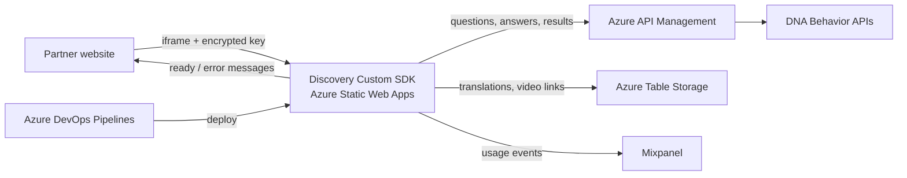

# Discovery Custom SDK – Documentation

12 October 2026

---

## 1. Project Overview

The Discovery Custom SDK is a web application that partner websites embed in their own pages through an iframe. Participants use it to take the DNA Behavior Discovery assessment without leaving the partner's site.

Inside the SDK, participants read the instructions, choose a language, and answer the Discovery questionnaire. When they finish, they see a results dashboard (natural style, Market Mood, Performance Keys, Behavioral Biases, and style videos) and can download their BDNA or FDNA report as a PDF.

Assessment data comes from the DNA Behavior APIs through Azure API Management, and translations and video links come from Azure Table Storage. The app is hosted on Azure Static Web Apps and deployed by Azure DevOps pipelines.

The partner website loads the SDK and passes the participant's details, the SDK reads content from Azure Storage and the DNA Behavior APIs, and Azure DevOps publishes each new version to Azure Static Web Apps.

---

## 2. Tech Stack and Packages

The app is built with Angular 18 and TypeScript 5.5, and the pipelines build it on Node.js 18.x.

| Package | Version | Purpose |
|---|---|---|
| @angular/core, common, router, forms, animations | 18.2 | Application framework |
| @angular/cli, @angular-devkit/build-angular | 18.2 | Build tooling and local development server |
| rxjs | 7.8 | Handles API calls and app data flow |
| primeng, primeicons, primeflex | 17.18 / 7.0 / 3.3 | UI components, icons, and layout |
| bootstrap | 5.3 | Base styling and layout |
| @ngx-translate/core, @ngx-translate/http-loader | 15.0 / 8.0 | Multi-language text |
| jspdf | 2.5 | Exports BDNA and FDNA reports as PDF |
| ng-circle-progress, ng-qrcode | 1.7 / 18.0 | Score circles and QR codes in reports |
| mixpanel-browser | 2.59 | Usage analytics |
| jsencrypt, crypto-js | 3.3 / 4.2 | Decrypts the key sent by the partner site and encrypts locally stored data |

Unit tests use Karma and Jasmine, and code style follows the .editorconfig file. The full package list is in package.json.

---

## 3. Environment Configuration

Each build configuration in angular.json swaps environment.ts for its own environment file at build time.

| Build configuration | Environment file | Source of values |
|---|---|---|
| local (default) | environment.ts | Values written in the file |
| dev | environment.dev.ts | Values written in the file |
| qa | environment.qa.ts | Values written in the file |
| sandbox | environment.sandbox.ts | Values written in the file |
| production | environment.prod.ts | Values written in the file |

There is no .env.example file. The variables are listed in src/environments/environment.ts, and the deployment tokens are stored as Azure DevOps pipeline variables.

| Variable | Description | Required |
|---|---|---|
| langApiUrl | Azure Table Storage address | Yes |
| languageTable | Name of the translations table | Yes |
| uniqueStyleVideoLinks | Name of the style video links table | Yes |
| azureSharedAccessKey | SAS token for reading Azure Table Storage | Yes |
| publicApiUrl | Base URL of the DNA Behavior public API (through API Management) | Yes |
| privateNoAuthUrl | Base URL for API endpoints that do not need sign-in | Yes |
| mixpanelToken | Mixpanel project token | Yes |
| httpTimeout | API request timeout in milliseconds | Yes |
| privateKey | Key used to decrypt the subscription key sent by the partner site | Yes |
| DEV Token, QA Token, Sandbox Token, ProdSdkToken | Azure Static Web Apps deployment tokens (pipeline variables) | Yes |

---

## 4. Azure Storage and Expiry

Azure Storage is Microsoft's cloud service for storing data. This project uses Azure Table Storage, which holds simple rows of data, to read translations and video links.

**The production SAS token in environment.prod.ts shows an expiry date of 31 March 2026. Without a valid token, the production SDK cannot load translations and stops at its error screen (renewal status: To confirm).**

| Storage account | Environments |
|---|---|
| sauatenvironment | Local, Dev, QA, Sandbox |
| saproddnabehavior | Production |

| Tables/Containers | Purpose |
|---|---|
| QADiscoveryLanguageV1 (Local, Dev, QA), SDKLanguageTable (Sandbox, Production) | All on-screen text in every supported language |
| BDNAUniqueStyleVideoLinks | Video links shown for each behavioral style |

| Item | Type | Expiry date |
|---|---|---|
| saproddnabehavior access token (Production) | SAS token | 31 March 2026 |
| sauatenvironment access token (Local, Dev, QA, Sandbox) | SAS token | 8 January 2027 |
| Static Web Apps deployment tokens (Dev, QA, Sandbox, Production) | Deployment token | To confirm |

---

## 5. Environments and Deployment

Commits to the development branch deploy to Dev and then QA, and commits to the main branch deploy to Sandbox and then Production.

| Environment | URL | Branch | Deployment trigger |
|---|---|---|---|
| Dev | To confirm | development | Automatic on commit (Discovery-Custom-SDK-Dev-QA.yml) |
| QA | To confirm | development | Automatic after Dev succeeds; approval gate To confirm |
| Sandbox | To confirm | main | Automatic on commit (Discovery-Custom-SDK-Sandbox-Prod.yml) |
| Production | To confirm | main | Automatic after Sandbox succeeds; approval gate To confirm |

**Deployment steps**

1. A developer merges changes into the development branch (for Dev/QA) or the main branch (for Sandbox/Production).
2. Azure DevOps starts the matching pipeline on an Ubuntu build agent with Node.js 18.x.
3. The pipeline installs packages and builds the app with the matching configuration (dev, qa, sandbox, or production).
4. The build output is published as a pipeline artifact.
5. The deployment stage downloads the artifact and uploads it to Azure Static Web Apps using that environment's deployment token.
6. The pipeline repeats the build and deploy for the second environment (QA after Dev, Production after Sandbox).
